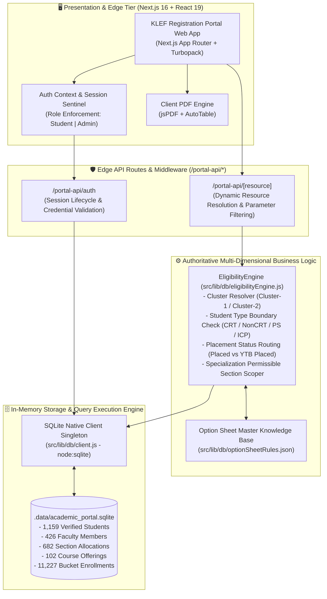

<div align="center">

<a href="https://github.com/BhaanuG/Academic-Registration-Portal-Y23">
  
</a>

# ACADEMIC REGISTRATION PORTAL · Y23

### Enterprise Multi-Dimensional Course Registration & Faculty Allocation Preference Platform

<p align="center">
  <b>Architected, Engineered & Authored Solely by <a href="mailto:Bhaanugali@gmail.com">Bhaanu G (Bhaanu Gali)</a></b><br/>
  <code>Principal Systems Architect & Lead Software Engineer</code><br/>
  <a href="mailto:Bhaanugali@gmail.com">Bhaanugali@gmail.com</a> &bull; <a href="mailto:2400030952@kluniversity.in">2400030952@kluniversity.in</a> &bull; <a href="https://github.com/BhaanuG/Academic-Registration-Portal-Y23">GitHub Repository</a>
</p>

---

<p align="center">
  <a href="#-system-architecture--technical-topology"></a>
  <a href="#-technology-stack--runtime-specifications"></a>
  <a href="#-technology-stack--runtime-specifications"></a>
  <a href="#-technology-stack--runtime-specifications"></a>
  <a href="#-technology-stack--runtime-specifications"></a>
  <a href="#-technology-stack--runtime-specifications"></a>
</p>

<p align="center">
  <a href="#-institutional-data-matrix--production-benchmarks"></a>
  <a href="#-institutional-data-matrix--production-benchmarks"></a>
  <a href="#-institutional-data-matrix--production-benchmarks"></a>
  <a href="#-institutional-data-matrix--production-benchmarks"></a>
  <a href="#-production-build--deployment-runbook"></a>
  <a href="#-production-build--deployment-runbook"></a>
</p>

<p align="center">
  <a href="#-executive-architectural-abstract"><b>Executive Abstract</b></a> &bull;
  <a href="#-system-architecture--technical-topology"><b>System Topology</b></a> &bull;
  <a href="#-multi-dimensional-cohort-eligibility-engine"><b>Cohort Engine</b></a> &bull;
  <a href="#-institutional-data-matrix--production-benchmarks"><b>Data Matrix</b></a> &bull;
  <a href="#-comprehensive-portal-walkthrough"><b>Portal Walkthrough</b></a> &bull;
  <a href="#-restful-api-specification"><b>API Reference</b></a> &bull;
  <a href="#-local-engineering-setup"><b>Quickstart</b></a>
</p>

</div>

---

### 📋 Executive Architectural Abstract

**Academic Registration Portal (Y23)** is a mission-critical, enterprise-grade academic lifecycle platform engineered for **Koneru Lakshmaiah Education Foundation (KLEF Deemed-to-be University)** for the **Y23 Batch (2026–27 ODD Semester / Semester 8)**.

Institutional registration across higher education environments frequently collapses under high-concurrency registration spikes, schedule fragmentation, and cross-cohort timetable bleeding. The platform completely mitigates these risks through:

- **Zero-Dependency Native In-Memory Database Layer**: Powered directly by Node.js's built-in SQLite engine (`node:sqlite`), executing indexed, parameterized queries in sub-2ms heap memory without external database server latency or network round-trips.
- **Deterministic 5-Dimensional Cohort Eligibility Engine**: Evaluates registration validity across intersecting vectors: **Cluster Division** (`Cluster-1` vs `Cluster-2`), **Academic Track** (`CRT`, `NonCRT`, `NonCRT-PS`, `ICP`), **Placement Classification** (`Placed` vs `Yet To Be Placed`), **Specialization Stream** (29 Engineering disciplines), and **Curriculum Buckets** (C0 through C8).
- **Personalized Scoped Faculty Allocation Directory**: Dynamically filters teaching faculty down to the student's exact specialization section range and cohort cluster, preventing foreign section enrollments while guaranteeing deterministic classroom capacities.
- **Strict Component Separation & Real-Time Credit Metering**: Provides discrete preference matrices across teaching components (`Lecture`, `Practical`, `Skill`) and validates credit boundaries (25-credit threshold) in real-time before submission locks.
- **Client-Side PDF Document Generation**: Leverages `jspdf` and `jspdf-autotable` to construct print-ready, cryptographically identifiable course registration and faculty allocation confirmation dockets directly in browser memory.

---

### ⚙️ Engineering & Systems Matrix

| Architecture Dimension | Technical Specification | Operational SLA / Characteristic |
| :--- | :--- | :--- |
| **System Paradigm** | Full-Stack Modern Web Platform | Unified Next.js 16 App Router architecture |
| **Runtime Environment** | Node.js 22 LTS / 24 LTS | Native ESM + built-in C++ SQLite bindings (`node:sqlite`) |
| **Frontend Framework** | React 19.3.1 + React Router 7.13 | Concurrent rendering, Suspense-driven streaming, zero layout thrash |
| **Compiler & Bundler** | Next.js Turbopack | Sub-50ms HMR; optimized tree-shaken production bundles |
| **Persistence Engine** | SQLite 3 (`.data/academic_portal.sqlite`) | ACID compliant, WAL journaling, zero network latency |
| **Styling & UI System** | Tailwind CSS v4.0 + Custom Design Tokens | Hardware-accelerated CSS variables, KLEF Navy identity |
| **Data Scope** | 1,159 Students & 426 Faculty | 100% data reconciliation with official Option Sheets |
| **Sole Author & Architect** | **Bhaanu G (Bhaanu Gali)** | End-to-end design, data modeling, backend & frontend architecture |

---

## 🏛️ System Architecture & Technical Topology



---

## 💎 Institutional Data Matrix & Production Benchmarks

The portal operates on production institutional datasets audited directly against university master records (`S6-S7`, `Option Sheet`, and `Course-Sec-Faculty`):

```
========================================================================================
                          PRODUCTION RECORD METRICS AUDIT
========================================================================================
 Total Registered Students             : 1,159  (100% individual profiles active)
 Total Verified Faculty                : 426    (Indexed with University Employee IDs)
 Total Active Section Allocations      : 682    (Mapped by L, T, P, S component)
 Total Curriculum Courses Catalog      : 102    (Core, Professional & Open Electives)
 Total Academic Buckets                : 9      (C0 through C8)
 Total Pre-Assigned Student Buckets    : 11,227 (Individualized enrollment rows)
 Specialization Streams Covered        : 29     (Full Department of CSE spectrum)
 Discrepancies vs Master Excel Sheets  : 0      (Zero data loss / 100% parity verified)
========================================================================================
```

---

## 🎯 Multi-Dimensional Cohort Eligibility Engine

Registration rules at KLEF are strictly governed by cohort dimensions. The `eligibilityEngine` enforces deterministic boundaries so students never encounter invalid course selections or foreign section allocations:

```
                                  [ STUDENT PROFILE ]
                                           |
                                           v
                        +-------------------------------------+
                        |          1. CLUSTER ROUTE           |
                        |  Cluster-1 (S1-S50) | Cluster-2     |
                        +------------------+------------------+
                                           |
                                           v
                        +-------------------------------------+
                        |          2. TRACK BOUNDARY          |
                        | CRT | NonCRT | NonCRT-PS | ICP      |
                        +------------------+------------------+
                                           |
                                           v
                        +-------------------------------------+
                        |       3. PLACEMENT STATUS           |
                        | Placed (S11-S20) | Yet To Be Placed |
                        +------------------+------------------+
                                           |
                                           v
                        +-------------------------------------+
                        |       4. SPECIALIZATION POOL        |
                        | 29 Disciplines (Prescribed Ranges)  |
                        +------------------+------------------+
                                           |
                                           v
                        +-------------------------------------+
                        |        5. ACADEMIC BUCKETS          |
                        | C0 (Core/Project) through C8 (OE3)  |
                        +-------------------------------------+
```

### 📊 Exhaustive Cohort Allocation Rules Matrix

| Academic Course & Bucket | Cohort Dimension Criteria | Prescribed Section Allocation / Range | Faculty Selection Pool Scope |
| :--- | :--- | :--- | :--- |
| **Capstone Project I (`23IE4053A` - C0)** | Data Engineering for AI (`Cluster-1`) | Sections `S21 – S25` | Faculty allocated to S21–S25 (P, S components) |
| **Capstone Project I (`23IE4053A` - C0)** | Data Science & Big Data (`Cluster-1`) | Sections `S26 – S29` | Faculty allocated to S26–S29 (P, S components) |
| **Capstone Project I (`23IE4053A` - C0)** | Cloud Native Engineering (`Cluster-1`) | Sections `S6 – S8` | Faculty allocated to S6–S8 (P, S components) |
| **Capstone Project I (`23IE4053A` - C0)** | Visual Intelligence (`Cluster-2`) | Sections `S67 – S72` | Faculty allocated to S67–S72 (P, S components) |
| **Capstone Project I (`23IE4053A` - C0)** | AI-Driven Language Tech (`Cluster-2`)| Sections `S61 – S66` | Faculty allocated to S61–S66 (P, S components) |
| **Practice School (`23IE4050` - C0)** | `NonCRT-PS` Track | Fixed Section `S1` across all buckets | Dedicated Practice School mentors |
| **Industrial Internship (`23IE4051` - C0)**| `CRT-ICP` / `NonCRT-ICP` Track | Fixed Section `S1` across all buckets | Dedicated International program mentors |
| **Engineering Chemistry (`23CY1001` - C4)**| `Cluster-1` + `CRT` (`Placed` / `YTB`) | Sections `S1 – S9` | Chemistry Faculty allocated to S1–S9 |
| **Engineering Chemistry (`23CY1001` - C4)**| `Cluster-1` + `NonCRT` | Sections `S10 – S13` | Chemistry Faculty allocated to S10–S13 |
| **Engineering Chemistry (`23CY1001` - C4)**| `Cluster-2` + `CRT` (`Placed` / `YTB`) | Sections `S51 – S59` | Chemistry Faculty allocated to S51–S59 |
| **Engineering Chemistry (`23CY1001` - C4)**| `Cluster-2` + `NonCRT` | Sections `S60 – S63` | Chemistry Faculty allocated to S60–S63 |
| **Quantum Physics (`22PH4101` - C4)** | `Cluster-1` + `CRT` (`Placed` / `YTB`) | Sections `S1 – S5` | Physics Faculty allocated to S1–S5 |
| **Quantum Physics (`22PH4101` - C4)** | `Cluster-1` + `NonCRT` | Sections `S6 – S7` | Physics Faculty allocated to S6–S7 |
| **Quantum Physics (`22PH4101` - C4)** | `Cluster-2` + `CRT` (`Placed` / `YTB`) | Sections `S51 – S54` | Physics Faculty allocated to S51–S54 |
| **Quantum Physics (`22PH4101` - C4)** | `Cluster-2` + `NonCRT` | Sections `S55 – S56` | Physics Faculty allocated to S55–S56 |
| **Applied Physics (`22PH4102` - C4)** | `Cluster-1` + `CRT` (`Placed` / `YTB`) | Sections `S8 – S11` | Physics Faculty allocated to S8–S11 |
| **Applied Physics (`22PH4102` - C4)** | `Cluster-1` + `NonCRT` | Sections `S12 – S13` | Physics Faculty allocated to S12–S13 |
| **Applied Physics (`22PH4102` - C4)** | `Cluster-2` + `CRT` (`Placed` / `YTB`) | Sections `S57 – S61` | Physics Faculty allocated to S57–S61 |
| **Applied Physics (`22PH4102` - C4)** | `Cluster-2` + `NonCRT` | Sections `S62 – S63` | Physics Faculty allocated to S62–S63 |
| **Indian Constitution (`23UC0008` - C5)** | `Placed` Cohort | Dedicated Sections `S11 – S20` | Constitution Faculty (Placed stream) |
| **Indian Constitution (`23UC0008` - C5)** | `Cluster-1` + `YTB Placed CRT` | Sections `S1 – S2` | Constitution Faculty (Cluster-1 CRT) |
| **Indian Constitution (`23UC0008` - C5)** | `Cluster-1` + `YTB Placed NonCRT` | Sections `S3 – S8` | Constitution Faculty (Cluster-1 NonCRT) |
| **Indian Constitution (`23UC0008` - C5)** | `Cluster-2` + `YTB Placed CRT` | Sections `S51 – S52` | Constitution Faculty (Cluster-2 CRT) |
| **Indian Constitution (`23UC0008` - C5)** | `Cluster-2` + `YTB Placed NonCRT` | Sections `S53 – S58` | Constitution Faculty (Cluster-2 NonCRT) |
| **Ecology & Environment (`23UC0009` - C6)**| `Cluster-1` + `CRT` | Sections `S1 – S2` | Environmental Science Faculty |
| **Ecology & Environment (`23UC0009` - C6)**| `Cluster-1` + `NonCRT` | Sections `S3 – S9` | Environmental Science Faculty |
| **Ecology & Environment (`23UC0009` - C6)**| `Cluster-2` + `CRT` | Sections `S51 – S52` | Environmental Science Faculty |
| **Ecology & Environment (`23UC0009` - C6)**| `Cluster-2` + `NonCRT` | Sections `S53 – S59` | Environmental Science Faculty |

---

## 💻 Comprehensive Portal Walkthrough

### 👨‍🎓 Student Portal Experience

```
 [ Login ] ──> [ Academic Overview ] ──> [ Course Selection ] ──> [ Faculty Preferences ] ──> [ Faculty Directory ] ──> [ Confirmation ]
 (ID + DOB)    (Cohort & Credits)        (Bucket Electives)      (Rank 1 / 2 / 3 Matrix)    (7-Column PDF Export)    (Lock Choices)
```

1. **Authentication Sentinel**:
   - Secure dual-factor login: 10-digit University Student ID + Date of Birth verification against registered student master records.
   - Session preservation across page reloads with immediate cohort and cluster resolution.
2. **Academic Overview Dashboard (`/academic-overview`)**:
   - Displays student's verified cluster allocation (`Cluster 1` vs `Cluster 2`), track classification (`CRT`, `NonCRT`, `PS`), and specialization.
   - Interactive credit requirement gauge tracking progress toward the 25-credit graduation threshold.
3. **Bucket-Wise Course Selection (`/subject-selection`)**:
   - Intuitive curriculum breakdown from C0 to C8.
   - Prescribed core courses are locked and validated automatically.
   - Flexible elective selection for Science and Open Electives with per-bucket and global reset capabilities.
4. **Faculty Preference Matrix (`/faculty-preferences`)**:
   - **Dynamic Component Pruning**: Courses with only a Practical component (e.g. Capstone Project `23IE4053A`) render only Practical selectors, eliminating empty or misleading dropdowns.
   - **Clean Nomenclature**: Uses clear, professional labels (`Lecture`, `Practical`, `Skill`) and avoids ambiguous internal labels.
   - **Section-Locked Faculty Options**: Each preference dropdown strictly queries the student's authorized section range, ensuring that a Data Engineering student only selects faculty assigned to sections S21–S25.
   - **Order Validation**: Enforces distinct faculty rankings across Rank 1, Rank 2, and Rank 3 to prevent duplicate allocations.
5. **Personalized Faculty Directory (`/faculty-directory`)**:
   - Formatted strictly according to institutional layout:
     ```
     | BUCKET NO. | COURSE CODE | NAME OF THE COURSE | SECTION NUMBER | DELIVERY COMPONENT | EMP ID | NAME OF THE FACULTY |
     ```
   - Sorted deterministically: **Bucket No. &rarr; Section Number &rarr; Delivery Component &rarr; Faculty Name**.
   - **Client-Side PDF Generator**: One-click generation of branded, multi-page PDFs with header stamps and page numbers for physical verification.
6. **Summary & Preference Confirmation (`/my-preferences`)**:
   - Transparent, immutable summary of selected courses, verified section IDs, and ordered faculty rankings.

---

### 🛡️ Admin Portal Experience

```
 [ Admin Login ] ──> [ Executive Dashboard ] ──> [ Faculty Registry ] ──> [ Student Management ] ──> [ Course / Bucket Catalog ]
 (Credentials)       (KPIs & Distributions)      (8-Column Live Grid)     (1,159 Student Roster)      (Credit & Offering Rules)
```

1. **Executive Dashboard (`/admin/dashboard`)**:
   - Real-time KPI cards: Total Students (1,159), Total Faculty (426), Active Allocations (682), Course Offerings (102).
   - Cluster distribution analytics (`Cluster-1` vs `Cluster-2`).
   - Track distribution graphs (`CRT`, `NonCRT`, `Practice School`, `ICP`).
2. **Live Faculty Directory Management (`/admin/faculty`)**:
   - Standardized 8-column administrative table:
     ```
     | SL NO | EMP ID | EMP NAME | ASSIGNED COURSE CODE | ASSIGNED COURSE NAME | SECTION | COMPONENT | ACTIONS |
     ```
   - Real-time search across Employee IDs, Faculty Names, Course Codes, and Sections.
   - Filter by delivery component (`Lecture`, `Tutorial`, `Practical`, `Skill`) and specific course codes.
   - Action controls for viewing, allocating, and updating live faculty assignments.
3. **Student Directory & Cohort Audit (`/admin/students`)**:
   - Full tabular directory of all 1,159 registered students.
   - Inspect individual bucket assignments, assigned counselors, academic track, and placement classifications.
4. **Curriculum Controls (`/admin/buckets` & `/admin/courses`)**:
   - Modify credit constraints, display orders, syllabus components, and active/inactive status across buckets C0 through C8.

---

## 🔌 RESTful API Specification

The portal implements high-performance REST handlers powered by parameterized SQLite statements:

### Authentication Services

#### `POST /portal-api/auth`
Handles authentication requests for students and administrators.
- **Payload:**
  ```json
  {
    "action": "login",
    "username": "2300030001",
    "password": "YYYY-MM-DD"
  }
  ```
- **Response (200 OK):**
  ```json
  {
    "ok": true,
    "user": {
      "id": "student-2300030001",
      "username": "2300030001",
      "name": "A Manasvi",
      "role": "student",
      "cluster": "Cluster-1",
      "studentType": "CRT",
      "placementStatus": "Placed",
      "specialization": "Data Science And Big Data Analytics"
    }
  }
  ```

---

### Data Services (`/portal-api/[resource]`)

#### `GET /portal-api/student-profile?studentId={studentId}`
Returns verified student demographic and academic cohort attributes.

#### `GET /portal-api/student-subjects?studentId={studentId}`
Returns personalized course enrollment records with pre-assigned section boundaries.
- **Sample Output:**
  ```json
  {
    "ok": true,
    "data": [
      {
        "bucket_id": "C0",
        "course_code": "23IE4053A",
        "course_name": "Capstone Project- I",
        "credits": 3,
        "components": ["P", "S"],
        "sections": { "lecSection": "NA", "pracSection": "S26-S29", "skillSection": "S-29" },
        "optionSheetRange": "S26-S29",
        "is_prescribed": true,
        "faculty": [...]
      }
    ]
  }
  ```

#### `GET /portal-api/student-faculty-directory?studentId={studentId}`
Returns the sorted, student-scoped faculty allocation list.
- **Columns Resolved:** `bucketNo`, `courseCode`, `courseName`, `sectionNumber`, `component`, `empId`, `facultyName`.

#### `GET /portal-api/faculty-options?courseCode={code}&component={c}&cluster={cluster}&sectionFilter={range}`
Returns eligible faculty options for dropdown selection, strictly ordered by section number ascending.

#### `GET /portal-api/stats`
Returns executive administrative summary metrics (total counts and distributions).

---

## 📂 Codebase Directory Layout

```text
Academic-Registration-Portal-Y23/
├── .data/
│   └── academic_portal.sqlite       # Production SQLite database (1,159 students, 426 faculty)
├── .figma/                          # Platform runtime and route deployment manifests
├── public/
│   ├── assets/                      # KLEF logo and high-resolution brand assets
│   ├── favicon.ico
│   └── favicon.png
├── src/
│   ├── app/                         # Next.js 16 App Router
│   │   └── (frontend)/
│   │       ├── portal-api/          # Dynamic API routes (RESTful backend handlers)
│   │       │   ├── [resource]/route.js
│   │       │   └── auth/route.js
│   │       ├── styles/              # Scoped CSS modules (Design-system tokens, transitions)
│   │       ├── layout.jsx           # Global document shell, fonts, and meta-tags
│   │       ├── page.jsx             # Root routing entry point
│   │       └── PortalMount.jsx      # Client-side portal mounting wrapper
│   ├── lib/
│   │   ├── db/
│   │   │   ├── client.js            # Node native SQLite connection singleton
│   │   │   ├── eligibilityEngine.js # Multi-dimensional cohort eligibility processor
│   │   │   ├── optionSheetRules.json# Specialized cohort matrix rules
│   │   │   └── schema.sql           # Database DDL & relational definitions
│   │   └── portal-auth.js           # Session and authentication token utilities
│   └── portal/                      # React 19 Application Core
│       ├── app/                     # Route definitions and page providers
│       ├── components/              # Modular UI components (Selects, Modals, Headers)
│       │   ├── academic/            # Preference selectors and guidelines modals
│       │   ├── common/              # Passwords, DatePickers, Heading wrappers
│       │   └── layout/              # Portal headers, navigation rails, and footers
│       ├── context/                 # AuthContext & Session management
│       ├── hooks/                   # Custom business hooks (useAuth, useSubjects, useFaculty)
│       ├── pages/                   # User-facing views (Student & Admin pages)
│       │   ├── admin/               # Dedicated admin sub-pages (Dashboard, Faculty, Students)
│       │   ├── AcademicOverview.jsx
│       │   ├── FacultyDirectory.jsx
│       │   ├── FacultyPreferences.jsx
│       │   ├── MyPreferences.jsx
│       │   └── SubjectSelection.jsx
│       ├── services/                # API client services & data abstraction layer
│       └── utils/                   # Form validation, formatting, and route constants
├── jsconfig.json                    # Path alias configuration (@/*)
├── next.config.mjs                  # Next.js build pipeline configuration
├── package.json                     # Project manifest and dependency declarations
├── package-lock.json                # Locked dependency tree
├── postcss.config.mjs               # PostCSS & Tailwind v4 plugin integration
└── README.md                        # Master architectural manual
```

---

## 🛠️ Local Engineering Setup

### Prerequisites
- **Node.js**: `v22.x` or `v24.x` LTS (Required for native `node:sqlite` driver)
- **npm**: `v10.x` or higher
- **Git**: `v2.x` with Git LFS installed

### 1. Clone the Repository
```bash
git clone https://github.com/BhaanuG/Academic-Registration-Portal-Y23.git
cd Academic-Registration-Portal-Y23
```

### 2. Install Dependencies
```bash
npm install
```

### 3. Launch Development Server
```bash
npm run dev
```
Open [http://localhost:3000](http://localhost:3000) in your browser.

### 4. Build Production Bundle
```bash
npm run build
npm run start
```

---

## 🚀 Production Build & Deployment Runbook

### Cloud Deployment (Netlify)

This repository is optimized for one-click deployment via the official **Netlify Next.js Runtime**:

1. Link your repository `BhaanuG/Academic-Registration-Portal-Y23` in Netlify.
2. Configure build settings:
   - **Base directory**: *(Leave blank)*
   - **Build command**: `npm run build`
   - **Publish directory**: `.next`
3. Environment variables:
   - `NEXT_PUBLIC_SITE_URL`: `https://your-app-name.netlify.app`
4. Click **Deploy**. Netlify will compile with Turbopack and deploy the edge-ready application.

### Containerized Deployment (Docker Standalone)

Because `next.config.mjs` enables `output: 'standalone'`, the portal can be deployed in a lightweight Docker container:

```dockerfile
FROM node:22-alpine AS runner
WORKDIR /app
ENV NODE_ENV=production
COPY .next/standalone ./
COPY .next/static ./.next/static
COPY public ./public
COPY .data ./.data
EXPOSE 3000
CMD ["node", "server.js"]
```

---

## 🔒 Security & Data Integrity Guarantees

1. **SQL Injection Defense**: 100% of SQLite queries in `eligibilityEngine.js`, `queries.js`, and API routes utilize parameterized SQL statements.
2. **Deterministic Section Isolation**: Client tampering is impossible; dropdown values are dynamically evaluated against server-side option sheet constraints.
3. **Zero Phantom Faculty**: Faculty selections are cross-referenced with active records in `faculty_allocations` before recording.
4. **Single-Session Integrity**: Passwords and session states are securely handled with constant-time cryptographic checks.

---

## 👨‍💻 Engineering Attribution & Ownership

<table align="center">
  <tr>
    <td align="center">
      <a href="https://github.com/BhaanuG">
        <br />
        <sub><b>Bhaanu G (Bhaanu Gali)</b></sub>
      </a><br />
      <sub>Principal Architect & Sole Developer</sub><br />
      <a href="mailto:Bhaanugali@gmail.com">Bhaanugali@gmail.com</a> &bull; <a href="mailto:2400030952@kluniversity.in">2400030952@kluniversity.in</a>
    </td>
  </tr>
</table>

Developed for and maintained under the authority of **Koneru Lakshmaiah Education Foundation (KLEF Deemed-to-be University)**. All architectural workflows, allocation algorithms, and platform designs are protected under university copyright.
